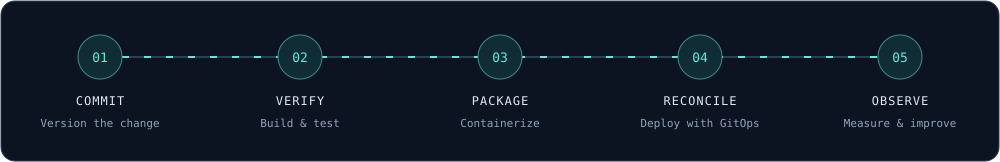

<p align="center">
  <a href="https://dogukancanerler.com/">
    
  </a>
</p>

<p align="center">
  <a href="https://dogukancanerler.com/"><strong>↗ Explore my terminal portfolio</strong></a>
  &nbsp; · &nbsp;
  <a href="https://dogukancanerler.com/assets/Dogukan_Canerler_CV.pdf">Read my CV</a>
  &nbsp; · &nbsp;
  <a href="https://www.linkedin.com/in/do%C4%9Fukan-canerler-ba4171187/">LinkedIn</a>
  &nbsp; · &nbsp;
  <a href="mailto:dogukanc760@hotmail.com">Email me</a>
</p>

<p align="center"><sub>Izmir, Türkiye · DevOps · Platform Engineering · Backend Systems</sub></p>

---

### From application code to production infrastructure.

I'm **Dogukan Canerler**, a **Senior DevOps & Backend Engineer** working across banking, fintech, e-commerce, and enterprise software. I build backend services and the infrastructure, delivery pipelines, and observability around them.

My work spans **Kubernetes platforms, GitOps delivery, infrastructure automation, and backend development with NestJS, .NET, and Go**. I care about repeatable deployments, useful telemetry, and systems that teams can operate with confidence.

<table>
<tr>
<td width="50%" valign="top">

**01 / PLATFORM & DELIVERY**

Kubernetes workloads, Docker images, Helm charts, and ArgoCD delivery. Infrastructure and environment configuration managed as code.

</td>
<td width="50%" valign="top">

**02 / BACKEND & RELIABILITY**

REST APIs, event-driven services, and database integrations. Logs, metrics, and delivery workflows that make production easier to understand.

</td>
</tr>
</table>

### A delivery loop worth automating



<sub>Illustrated workflow · versioned changes, repeatable releases, and feedback from production.</sub>

### Open the toolbox

<details open>
<summary><strong>▸ Platform, cloud & delivery</strong></summary>

| Area | Tools |
| :--- | :--- |
| Containers & orchestration | Kubernetes · Docker · Helm |
| GitOps & CI/CD | ArgoCD · Git · Azure DevOps · CI/CD pipelines |
| Infrastructure automation | Terraform · Ansible · Bash · Linux |
| Cloud | AWS · Azure |
| Observability | Prometheus · Grafana · Kibana · Elasticsearch |

</details>

<details>
<summary><strong>▸ Backend, data & application development</strong></summary>

| Area | Tools |
| :--- | :--- |
| Backend | NestJS · Node.js · .NET · Go |
| Languages | TypeScript · JavaScript · C# · Go · Bash |
| Data | PostgreSQL · MongoDB · Redis · SQL Server |
| Application background | React · React Native · Flutter |
| Integration | REST APIs · Event-driven services · Enterprise integrations |

</details>

<details>
<summary><strong>▸ Experience snapshot</strong></summary>

- **Panates Teknoloji — Senior DevOps & Backend Developer**  
  Kubernetes, GitOps/ArgoCD, backend microservices, infrastructure automation, and observability.
- **Akbank, via Maarifa — Senior DevOps & Software Developer**  
  Financial APIs, Azure DevOps pipelines, and containerized applications in a banking environment.
- **Earlier work across fintech, e-commerce, and enterprise software**  
  Backend services, marketplace integrations, web/mobile applications, and delivery automation.

[Read the full experience →](https://dogukancanerler.com/) · [Open CV →](https://dogukancanerler.com/assets/Dogukan_Canerler_CV.pdf)

</details>

### Explore my work

<table>
<tr>
<td width="50%" valign="top">

**[↗ Terminal Portfolio](https://dogukancanerler.com/)**

An interactive home for my experience, skills, and projects. Explore the terminal or start with **Recruiter Mode** for a quick overview.

`interactive portfolio` `career` `contact`

</td>
<td width="50%" valign="top">

**[↗ Logify Stack](https://github.com/dogukanc760/logify-stack)**

A NestJS starter with PostgreSQL, MongoDB, Elasticsearch, Docker Compose, and Kubernetes manifests. Includes basic JWT authentication.

`NestJS` `Docker` `Kubernetes` `starter`

</td>
</tr>
</table>

<details>
<summary><strong>▸ View my engineering profile as a manifest</strong></summary>

```yaml
# A profile, expressed as configuration.
apiVersion: profile.dev/v1
kind: Engineer
metadata:
  name: dogukan-canerler
  handle: dogukanc760
spec:
  focus:
    - platform-engineering
    - gitops-and-delivery
    - backend-systems
    - observability
  approach:
    - version-the-change
    - automate-repeatable-work
    - design-for-failure
    - make-systems-observable
  links:
    portfolio: https://dogukancanerler.com
    github: https://github.com/dogukanc760
```

</details>

---

<p align="center">
  <strong>Have a platform or backend challenge?</strong><br />
  <a href="mailto:dogukanc760@hotmail.com">Let's talk</a> · <a href="https://dogukancanerler.com/">Explore the portfolio</a>
</p>
