<p align="center">
<a href="https://dogukancanerler.com/"></a>
</p>

<p align="center">
<a href="https://dogukancanerler.com/"></a>
<a href="https://dogukancanerler.com/assets/Dogukan_Canerler_CV.pdf"></a>
<a href="https://www.linkedin.com/in/do%C4%9Fukan-canerler-ba4171187/"></a>
<a href="mailto:dogukanc760@hotmail.com"></a>
</p>

> **I build the services and the platforms behind them.**  
> Senior DevOps & Backend Engineer based in **Izmir, Türkiye**, with experience across banking, fintech, e-commerce, and enterprise software. My focus: cloud platforms, Kubernetes operations, GitOps delivery, infrastructure automation, identity, and observable backend systems.

### `~ $ help`

**Click a command to expand its output.** For the keyboard-driven terminal, [launch my portfolio ↗](https://dogukancanerler.com/).

<details open>
<summary><strong>☸ &nbsp; kubectl get platform --all-namespaces</strong> — Kubernetes · OpenShift · Rancher · cloud</summary>



**Platforms:** Kubernetes · OpenShift · Rancher · Docker · Helm · Linux  
**Cloud & IaC:** AWS · Azure · Google Cloud · Terraform · Ansible · Bash

</details>

<details>
<summary><strong>⟳ &nbsp; argocd app get delivery</strong> — GitOps · Keycloak · observability</summary>



**Delivery:** ArgoCD · GitOps · Azure DevOps · Git · CI/CD  
**Identity & edge:** Keycloak · NGINX  
**Signals & tooling:** Prometheus · Grafana · Kibana · Elasticsearch · Postman · REST · GraphQL

</details>

<details>
<summary><strong>λ &nbsp; cat services.yaml</strong> — backend · languages · databases</summary>



**Services:** NestJS · Node.js · Express · .NET · Go  
**Languages:** C# · TypeScript · JavaScript · Go · Bash  
**Data:** PostgreSQL · MongoDB · Redis · SQL Server · MySQL · MariaDB · SQLite

</details>

<details>
<summary><strong>▣ &nbsp; ls applications/</strong> — frontend · mobile · integrations</summary>



**Web & mobile:** React · React Native · Flutter · Dart · Bootstrap  
**Additional platform experience:** Heroku  
**Architecture & integration:** Microservices · Event-driven services · REST APIs · GraphQL · B2B/B2C · Marketplaces · Stock-exchange APIs · Payment gateways

</details>

<details>
<summary><strong>↳ &nbsp; cat reliability.md</strong> — how I approach production</summary>

```text
$ engineering principles
  [01] Version infrastructure and environment configuration.
  [02] Automate repeatable operational work.
  [03] Design delivery for safe rollout and recovery.
  [04] Make failures visible through useful telemetry.
  [05] Connect infrastructure decisions to application behavior.
```

My experience includes **zero-downtime deployment approaches, multi-stage CI/CD, environment segregation, high availability, fault tolerance, cluster lifecycle management, and network monitoring**.

</details>

### `~ $ topology --animate`



<sub>A map of my engineering toolkit; the animation illustrates flow, not live infrastructure status.</sub>

### `~ $ tail experience.log`

<details>
<summary><strong>Open experience log</strong> — Panates · Akbank via Maarifa · earlier roles</summary>



- **Panates Teknoloji:** Kubernetes, GitOps/ArgoCD, backend microservices, infrastructure automation, and observability.
- **Akbank, via Maarifa:** Financial APIs, Azure DevOps delivery pipelines, and containerized applications.
- **Earlier roles:** Banking/fintech integrations, e-commerce and marketplace systems, enterprise software, and web/mobile development.

[Full history and dates →](https://dogukancanerler.com/) · [CV →](https://dogukancanerler.com/assets/Dogukan_Canerler_CV.pdf)

</details>

### `~ $ ls featured/`

<p>
<a href="https://dogukancanerler.com/"></a>
<a href="https://github.com/dogukanc760/logify-stack"></a>
</p>

### `~ $ gh activity --watch`

<a href="https://github.com/dogukanc760?tab=repositories"></a>

<details open>
<summary><strong>▶ &nbsp; play contributions.snake</strong> — an animation generated from my GitHub contribution calendar</summary>


</details>

<sub>GitHub visuals refresh through <a href="https://github.com/dogukanc760/dogukanc760/actions/workflows/profile-visuals.yml">GitHub Actions</a>. Calendar animation powered by <a href="https://github.com/Platane/snk">Platane/snk</a>.</sub>

---

<p align="center"><code>dogukanc760@cloud-console:~ $</code> <a href="mailto:dogukanc760@hotmail.com"><strong>let's build something reliable ↗</strong></a></p>
