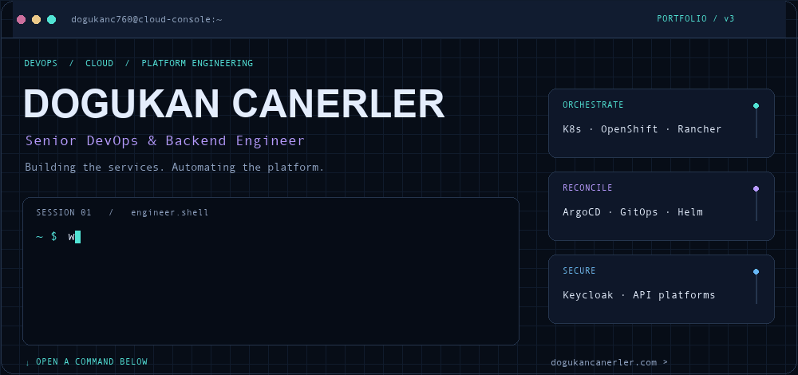
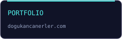
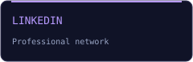
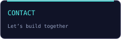
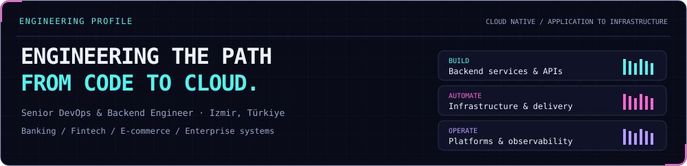
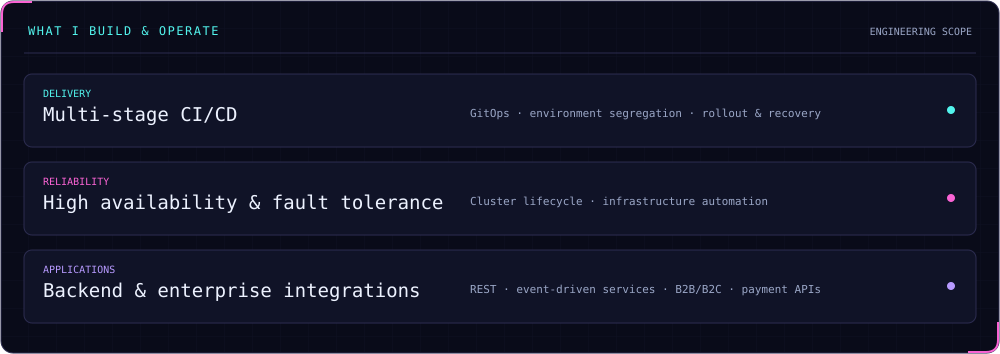
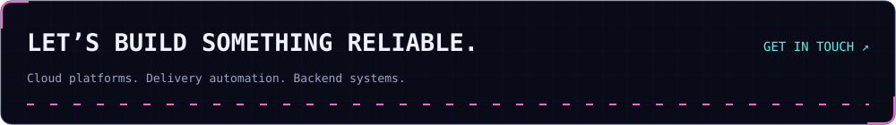

GitHub data refreshed by <a href="https://github.com/dogukanc760/dogukanc760/actions/workflows/profile-visuals.yml">GitHub Actions</a> · Contribution animation by <a href="https://github.com/Platane/snk">Platane/snk</a> · Architecture graphics are illustrative.

